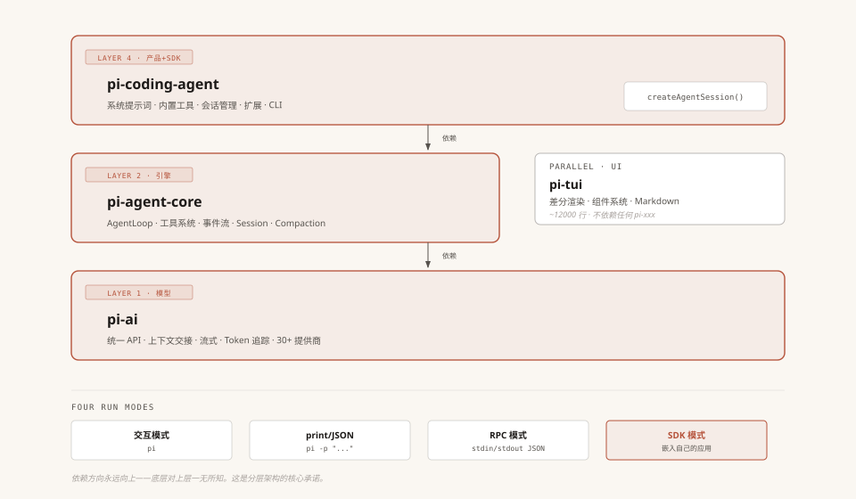
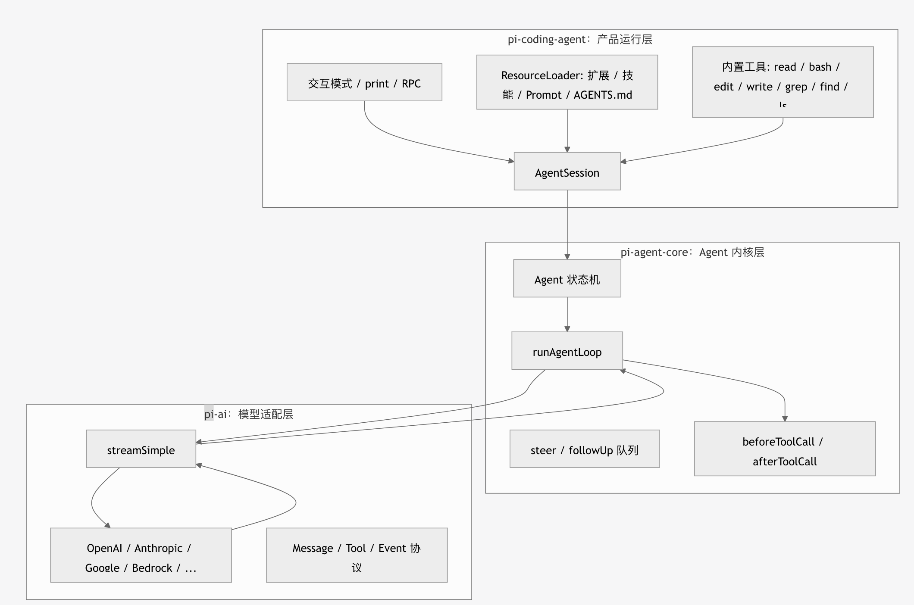

参考： https://dg-ai-notes.pages.dev/modules/ch06-messages/#%E4%BA%8C%E7%AC%AC%E4%B8%80%E5%B1%82llm-%E8%AE%A4%E8%AF%86%E7%9A%84%E6%B6%88%E6%81%AF%E5%8F%AA%E6%9C%89%E4%B8%89%E7%A7%8D


```plaintext
┌──────────────────────────────────────────┐
│          pi-coding-agent                 │  ← 完整 CLI 产品 + SDK
│  系统提示词 · 内置工具 · 会话管理 · 扩展      │
├──────────────────────────────────────────┤
│  pi-tui              │  pi-agent-core    │  ← 终端 UI + Agent 引擎
│  差分渲染 · 组件系统    │  AgentLoop · 工具 │
│                      │  系统 · 事件流     │
├──────────────────────┴───────────────────┤
│              pi-ai                       │  ← 多供应商 LLM 抽象
│  统一 API · 上下文交接 · 流式 · Token 追踪   │
└──────────────────────────────────────────┘
```





**配图说明**：四个核心包的分层依赖图。coding-agent 在顶层（产品+SDK），agent-core 在中层（引擎），pi-ai 在底层（模型抽象），pi-tui 是平行的 UI 层不依赖任何 AI 包。底部展示四种运行模式。


当然后面版本又增加了 MCP、 **CodeMode**、**Deferred tool loading**、**虚拟模型**、**缓存预热** 等多项功能

- **CodeMode（沙箱与工具编排）**：这是一个 harness-side 的沙箱环境，允许模型通过编写 JavaScript 代码来调用工具，并对执行结果进行筛选后再返回给模型。这样能有效控制上下文体积，官方数据显示标准工具描述从约 5300 tokens 压缩到了 3300 tokens。
    
- **Deferred tool loading（延迟工具加载）**：工具不再一次性全部塞给模型，而是按需动态加载。这避免了因为引入 MCP 等扩展导致 prompt 体积爆炸，维持了 Pi “小而精”的设计哲学。
    
- **虚拟模型（Virtual models）**：通过扩展支持将多个底层 AI 模型组合成一个“虚拟模型”来调用。例如，可以让 Claude Opus 做规划，当分类模型 Jev 判定进入实现阶段时，自动将任务移交给 GPT 执行。
    
- **缓存预热（Cache warming）**：针对 Anthropic 等模型优化等待时间，通过提前准备 prompt 缓存来降低延迟。
    
- **Pi Durable（独立组件）**：这是一个与 Pi Agent 本身分开的、用于构建长时运行 Agent 应用的底层框架。它负责处理多轮对话编排和存储后端（如 SQLite、JSONL），让 Pi 本体保持极简。


